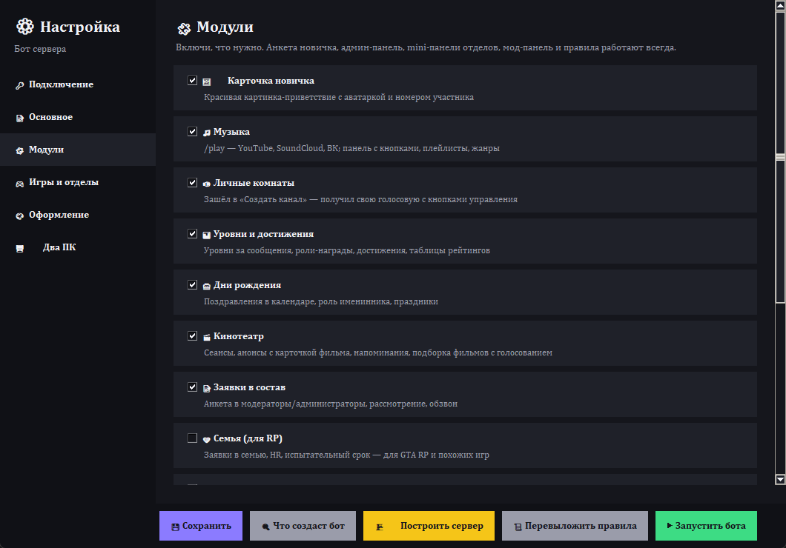
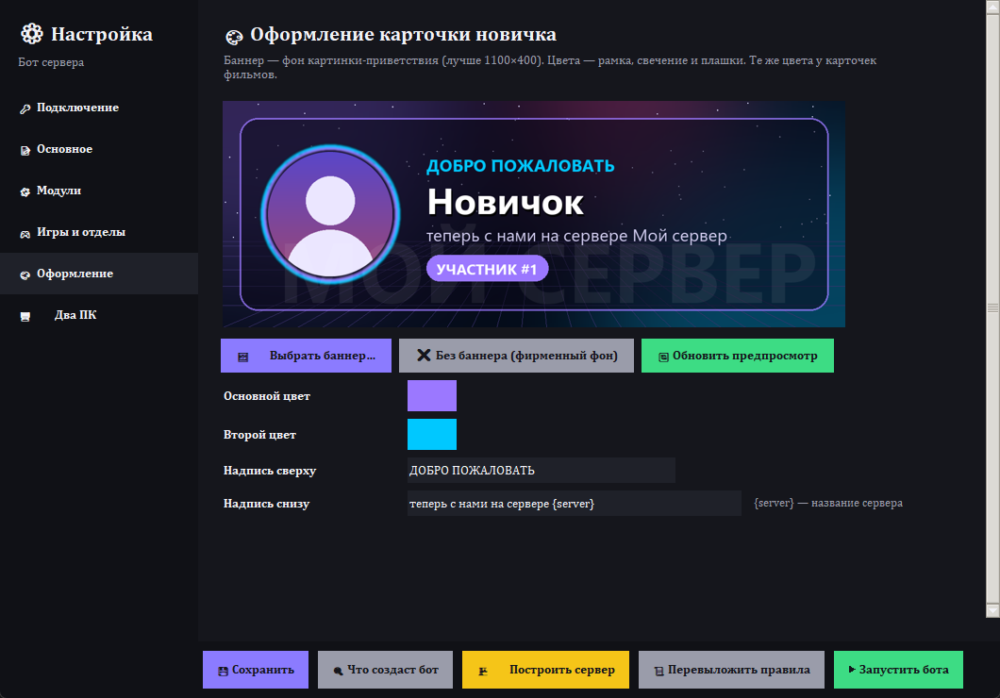

# 🤖 Бот для игрового Discord-сервера

Один бот, который сам строит сервер и держит в нём порядок: анкета для новичков, игровые отделы со своими
админами, музыка, личные голосовые комнаты, уровни и достижения, дни рождения, кинотеатр, заявки в администрацию,
защита от спама и многое другое. Всё на русском, всё через кнопки.

Настраивается **без программирования**: название сервера, игры, роли, баннер, цвета и нужные модули выбираются
в окне «Мастер настройки». Бот может работать **на двух компьютерах сразу**: если один выключился, бот сам
продолжит на втором.

<p align="center">
  
  
</p>

---

## 📋 Содержание

1. [Что умеет бот](#-что-умеет-бот)
2. [Что понадобится](#-что-понадобится)
3. [Установка: 5 шагов](#-установка-5-шагов)
4. [Мастер настройки](#-мастер-настройки)
5. [Что бот создаст на сервере](#-что-бот-создаст-на-сервере)
6. [Два ПК: бот не выключается](#-два-пк-бот-не-выключается)
7. [Команды](#-команды)
8. [Тонкая настройка](#-тонкая-настройка)
9. [Если что-то не работает](#-если-что-то-не-работает)

---

## ✨ Что умеет бот

| | Модуль | Что делает |
|---|---|---|
| 📝 | **Анкета новичка** | Новичок видит только канал старта и правила. Выбирает пол, дату рождения и игры, и сервер открывается. Обойти анкету нельзя: бот придерживает роли от других ботов, пока анкета не заполнена |
| 🎮 | **Игровые отделы** | У каждой игры своя роль и категория каналов (новости, чат, скриншоты, «Создать канал») и свой **mini Admin**: он модерирует только свой отдел и выдаёт роли отдела через свою панель |
| 🛠️ | **Админ-панель** | Всё кнопками: выдать или забрать роль, предупреждения, тайм-ауты, кик и бан с выбором причины, объявления, дни рождения участников, список ролей с подсказками «кому выдавать» |
| 🛡️ | **Мод-панель** | Отдельная панель для обычных модераторов: только наказания, без «опасных» кнопок |
| 🖼️ | **Карточка новичка** | Красивая картинка-приветствие с аватаркой и номером участника. Свой баннер и цвета |
| 🎵 | **Музыка** | `/play` по названию или ссылке (YouTube, SoundCloud, ВК), плейлисты, подборки по жанрам, панель с кнопками |
| 🔊 | **Личные комнаты** | Зашёл в «➕ Создать канал» и получил свою голосовую комнату. Её можно закрыть, переименовать, задать лимит, пригласить или выгнать человека. Опустела — бот её удалит |
| 📊 | **Уровни и достижения** | Уровни за сообщения, роли-награды (1000 сообщений → «Писатель»…), достижения («Полуночник», «Меломан», «Голос сервера»…), таблицы рейтингов |
| 🎂 | **Дни рождения** | Поздравления (разные для девушек и парней), роль «Именинник» на день, праздники в календаре |
| 🎬 | **Кинотеатр** | Сеансы с анонсом, напоминания за час и за 10 минут, карточка фильма с обложкой, подборка фильмов с голосованием, событие в «Мероприятиях» |
| 📝 | **Заявки в состав** | Анкета в модераторы или администраторы, рассмотрение кнопками, голосовой канал для обзвона |
| 🧡 | **Семья (RP)** | Для GTA RP и похожих игр: заявки в семью, HR, испытательный срок |
| 🛡️ | **Защита** | Антифлуд, антиспам, массовые упоминания, фишинговые ссылки (`steamcommunlty` и т.п.), защита от рейдов |
| 💡 | **Идеи и ⭐ зал славы** | Идеи с голосованием 👍/👎; сообщения, набравшие N ⭐, попадают в зал славы; недельная сводка; `/remind` |
| 📸 | **Только фото** | В каналах «скриншоты» бот удаляет сообщения без картинок |
| 👥 | **Счётчик участников** | Голосовой канал «Участников: N» |
| 🔞 | **Каналы 18+** | Закрытые каналы для девушек и парней 18+. Бот открывает их сам по анкете |
| 📰 | **Пересылка новостей** | Копирует посты из канала другого сервера в ваш канал |

Ненужные модули отключаются одной галочкой.

---

## 🧰 Что понадобится

- **Компьютер с Windows 10 или 11**, который почти всегда включён (бот работает, пока работает ПК).
  Второй ПК необязателен, но тогда бот не выключается вообще (см. [Два ПК](#-два-пк-бот-не-выключается)).
- **Свой Discord-сервер**, где ты владелец или администратор.
- **10–15 минут.** Всё остальное (Python, FFmpeg и прочее) установщик поставит сам.

---

## 🚀 Установка: 5 шагов

### Шаг 1. Создай бота в Discord

1. Открой [discord.com/developers/applications](https://discord.com/developers/applications) и войди.
2. Нажми **New Application**, придумай имя (его увидят на сервере) и нажми **Create**.
3. Слева открой **Bot**:
   - нажми **Reset Token**, затем **Copy**. Это ключ бота, вставишь его в Мастер на шаге 3.
     > ⚠️ Ключ — как пароль. Никому его не показывай и никуда не выкладывай.
   - ниже, в разделе **Privileged Gateway Intents**, включи **SERVER MEMBERS INTENT** и **MESSAGE CONTENT INTENT**,
     затем нажми **Save Changes**.
4. Можно поставить боту аватарку (раздел **General Information**).

### Шаг 2. Скачай и установи

1. Вверху этой страницы нажми зелёную кнопку **Code**, затем **Download ZIP**.
2. Распакуй архив (правой кнопкой → **Извлечь всё**).
3. В распакованной папке дважды нажми **`УСТАНОВИТЬ.bat`**.
   - Если Windows напишет «Система Windows защитила ваш компьютер», нажми **Подробнее**, затем
     **Выполнить в любом случае**.
4. Подожди 5–10 минут. Установщик сам поставит Python, FFmpeg, Deno и библиотеки бота и скопирует бота
   в папку `C:\Users\<ты>\DiscordBot`. В конце откроется **Мастер настройки**.

### Шаг 3. Подключи бота (Мастер → «🔑 Подключение»)

1. Вставь ключ бота из шага 1 и нажми **✅ Проверить**.
2. Нажми **➕ Пригласить бота на сервер**, выбери свой сервер и нажми **Авторизовать**.
   Бот получит право «Администратор»: оно нужно, чтобы создавать каналы и роли.
3. Снова нажми **✅ Проверить** и выбери свой сервер в списке **Сервер**.

### Шаг 4. Настрой под себя

Пройди вкладки слева: **Основное** (название сервера, роли), **Модули**, **Игры и отделы**, **Оформление**
(баннер и цвета). Подробнее о каждой вкладке — в разделе [Мастер настройки](#-мастер-настройки). Нажми **💾 Сохранить**.

### Шаг 5. Построй сервер и запусти

1. **🔍 Что создаст бот** покажет список того, что будет создано. Ничего не меняет, можно жать сколько угодно.
2. **🏗️ Построить сервер**: бот создаст недостающие роли, категории и каналы и выложит панели с кнопками.
   **Он ничего не удаляет** и не трогает уже существующие каналы: если канал с таким названием уже есть,
   бот возьмёт его.
3. **Важно:** в Discord открой **Настройки сервера → Роли** и **перетащи роль бота на самый верх**
   (под владельца). Иначе бот не сможет выдавать роли, которые стоят выше его роли.
   После этого ещё раз нажми **🏗️ Построить сервер**: бот расставит роли по порядку.
4. **▶ Запустить бота.** Бот запустится и дальше будет сам включаться вместе с компьютером.
   На рабочем столе появятся два ярлыка: **панель управления** (работает ли бот, перезапуск, логи)
   и **настройка** (этот Мастер).

Готово! 🎉 Зайди на сервер со второго аккаунта и проверь, как всё выглядит для новичка.

---

## ⚙️ Мастер настройки

<p align="center"></p>

| Вкладка | Что там |
|---|---|
| 🔑 **Подключение** | Ключ бота, выбор сервера, приглашение бота. Необязательно: токен ВК (для плейлистов ВК) и пересылка новостей |
| 📝 **Основное** | Имя бота, название сервера (используется в приветствиях, правилах и на картинках), ник бота на сервере, часовой пояс. Названия всех ролей: можно указать роли, которые у тебя уже есть, и бот возьмёт их. Название семьи, испытательный срок, сколько ⭐ нужно для зала славы и т.д. |
| 🧩 **Модули** | Галочки: что включить |
| 🎮 **Игры и отделы** | Список игр: эмодзи, название, роль. Для каждой игры бот создаст категорию с каналами и роль mini Admin. «Доп. роли отдела»: роли, которые может выдавать mini Admin этого отдела (например «Тестер») |
| 🎨 **Оформление** | Баннер (фон карточки новичка), два цвета, надписи. Сразу видно, как будет выглядеть |
| 🖥️ **Два ПК** | Включить синхронизацию и собрать установщик для второго компьютера |

<p align="center"></p>

**После изменения настроек** нажми **🏗️ Построить сервер** (если добавились игры или модули) и **▶ Запустить бота**:
бот перезапустится с новыми настройками.

Открыть Мастер можно в любой момент: ярлык **«… — настройка»** на рабочем столе или кнопка **⚙️ Настройки**
в панели управления.

---

## 🏗️ Что бот создаст на сервере

Названия можно поменять в настройках. Если у тебя уже есть канал с таким названием, бот возьмёт его.

```
━━❘│📢・Информация    📜 правила · 👋 старт (анкета) · 🎉 новички · 🔔 новости
━━❘│💬・Общение       💬 общий-чат · 😂 мемы · (🌸 девочки · 💪 мальчики — если включены 18+)
━━❘│📊・Активность    📅 календарь · 📊 уровни · 📊 достижения · 💡 идеи · ⭐ лучшее
━━❘│🔊・Голосовые     🎮 управление-комнатой · ➕ Создать канал · 👥 Участников: N
━━❘│💚・Minecraft     новости · чат · скриншоты · Создать канал      ← по категории на каждую игру
━━❘│🎬・Кинотеатр     🎬 афиша · 🍿 подборка · 🎬 Кинозал
━━❘│📝・Заявки…       📝 подать-заявку · 📨 заявки · 🎙️ Ожидание обзвона
━━❘│🧡・Семья         (если включена)
━━❘│🛠️・Админка       🛠️ админ-панель · 🧩 mini-панель · 🛡️ мод-панель · 💬 чаты · 📋 логи · 🏆 рейтинги · 🎬 кино-настройки
```

**Роли:** участник, новичок без анкеты, главный админ, главный модератор, администрация, модератор, роли пола,
роли игр и mini Admin каждой игры, уровни, достижения, именинник, киноман и т.д.

**Как устроены права:**
- новичок без анкеты видит только правила, старт и приветствия;
- игровую категорию видят только те, кто выбрал эту игру;
- **mini Admin** отдела может модерировать (удалять сообщения, мутить в голосовых, выдавать роли отдела)
  **только в своём отделе**;
- админку видят только администрация и главный модератор; модераторы видят только свою мод-панель и мод-чат.

---

## 🖥️ Два ПК: бот не выключается

Если поставить бота на два компьютера (например, твой и друга), работать будет **всегда ровно один**:

- главный ПК работает; если его выключили, примерно через минуту бот сам запустится на втором;
- главный включился — бот вежливо вернётся на него (без двойных ответов);
- **база** (уровни, дни рождения, фильмы…) переезжает вместе с ботом: снимок каждые 2 минуты;
- **настройки и обновления** тоже переезжают: изменил что-то в Мастере на одном ПК и нажал «Запустить бота» —
  второй ПК получит изменения сам.

Всё это идёт через закрытый служебный канал `🔧・bot-sync` на твоём сервере, никаких сторонних сервисов.

**Как включить:**
1. Мастер → **🖥️ Два ПК** → **🔗 Включить синхронизацию**, затем согласись перезапустить бота.
2. Впиши имя второго ПК, выбери его роль (главный или запасной) и нажми **📦 Собрать установщик**.
   На рабочем столе появится архив.
3. Передай архив на второй ПК **лично** (флешка, личные сообщения). ⚠️ В архиве лежит ключ бота!
4. На втором ПК: распаковать и запустить `УСТАНОВИТЬ.bat`. Больше ничего делать не нужно.

В панели управления видно, где сейчас работает бот: 🟢 на этом ПК, 🟡 на другом.

---

## ⌨️ Команды

Большинство функций работает **кнопками** в каналах (старт, админ-панель, комнаты, кинотеатр).
Слэш-команды:

| Для всех | |
|---|---|
| `/play` `/genre` `/skip` `/pause` `/queue` `/volume` `/stop` | музыка |
| `/room …` | управление своей голосовой комнатой (имя, лимит, закрыть, пригласить, выгнать) |
| `/rank` `/top` `/achievements` | уровень, топ, достижения |
| `/birthday set` `/birthday list` `/birthday privacy` | дни рождения |
| `/remind` | напомнить о чём-то: `30м`, `2ч`, `1д` или `18:30` |
| `/status` | где сейчас работает бот |

| Для администрации | |
|---|---|
| `/setup` | построить или достроить сервер (то же, что кнопка в Мастере) |
| `/setup-check` | показать, что `/setup` создаст, ничего не меняя |
| `/rules` | перевыложить правила |
| `/panels` | перевыложить панель анкеты |
| `/dept-admin add/remove` | назначить или снять mini Admin отдела |
| `/birthday add/remove` | день рождения участнику |
| `/digest` | итоги недели прямо сейчас |
| `/welcome-test` | посмотреть карточку приветствия на себе |

---

## 🔧 Тонкая настройка

Все настройки хранятся в файлах в папке бота (`C:\Users\<ты>\DiscordBot`):

| Файл | Что это |
|---|---|
| `settings.example.json` | **все** настройки по умолчанию с названиями всех каналов. Не меняй его |
| `settings.json` | твои настройки: только то, что отличается от примера. Его пишет Мастер, можно править вручную |
| `rules.json` | правила сервера (создаётся из `rules.example.json` кнопкой «📜 Открыть правила» во вкладке «Основное»). Подстановки: `{server}`, `{games}`, `{welcome}` |
| `.env` | ключ бота, ID сервера и служебные ID. **Никому не показывать** |
| `assets/welcome_bg.png` | твой баннер |

**Пример** `settings.json`, где переименован общий чат и уже существующая категория игры отдана боту
(бот её не перестраивает, только добавляет права mini Admin):

```json
{
  "bot": {"name": "Мой бот", "server_name": "Лампово"},
  "channels": {"general": {"name": "💬・болталка", "id": 123456789012345678}},
  "games": [
    {"name": "Minecraft", "role": "Minecraft", "emoji": "💚", "category_id": 223456789012345678},
    {"name": "Valorant", "role": "Valorant", "emoji": "❤️"}
  ]
}
```

Если у канала указан `id`, бот находит его даже после переименования.
ID канала: включи в Discord **Режим разработчика** (Настройки → Расширенные), затем ПКМ по каналу → **Копировать ID**.

**Обновление бота:** скачай новый ZIP отсюда и скопируй файлы в папку бота с заменой, **кроме** `.env`,
`settings.json`, `rules.json`, `bot.db`, `host.json` и папки `runtime`. Затем перезапусти бота из панели.
С двумя ПК достаточно обновить один и нажать в панели **📤 Опубликовать обновление**: второй обновится сам.

---

## 🆘 Если что-то не работает

| Проблема | Решение |
|---|---|
| Бот офлайн | Открой панель управления (ярлык на рабочем столе) и нажми **▶ Запустить**. Лог — кнопка **📜 Лог бота** |
| «Токен не подходит» | На портале разработчиков: Bot → **Reset Token**, скопируй новый и вставь в Мастер |
| Бот не видит участников и сообщения | Не включены **SERVER MEMBERS** и **MESSAGE CONTENT INTENT** (шаг 1). Мастер предупредит об этом при проверке |
| Бот не выдаёт роли | Роль бота должна стоять **выше** выдаваемых ролей: Настройки сервера → Роли, перетащи роль бота наверх |
| Нет слэш-команд | Подожди минуту после первого запуска и перезапусти Discord (Ctrl+R) |
| Музыка не играет | Установщик ставит FFmpeg сам. Если не вышло, установи вручную (`winget install Gyan.FFmpeg`) и перезагрузи ПК |
| Не рисуются картинки после включения ПК без интернета | Windows (Smart App Control) иногда блокирует библиотеку картинок без сети. Перезапусти бота из панели, когда появится интернет |
| Ошибки бота | Бот сам пишет их в канал **📋・логи** в админке |

---

## 🔒 Безопасность

- Ключ бота (`.env`) и база (`bot.db`) лежат только у тебя на компьютере и **не попадают** в git
  (см. `.gitignore`).
- Если ключ куда-то утёк, сразу нажми **Reset Token** на портале разработчиков и вставь новый в Мастер.
- Бот ничего не удаляет на сервере. В существующие каналы он только **добавляет** права своих ролей
  (новичок без анкеты, mini Admin), остальные права не трогает. Полностью он настраивает только свои служебные
  категории: админку и категории игр, которые создал сам.

## 📄 Лицензия

[MIT](LICENSE): пользуйся, меняй, делись.
