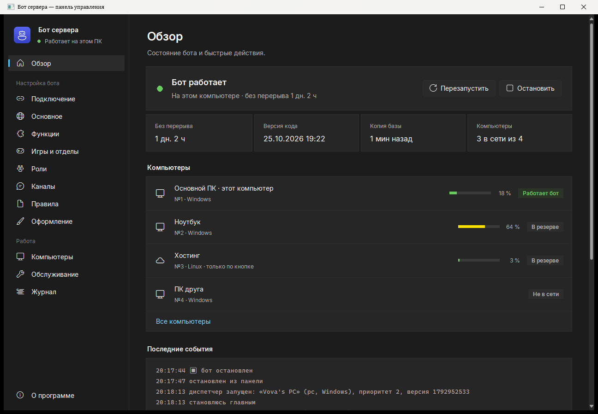
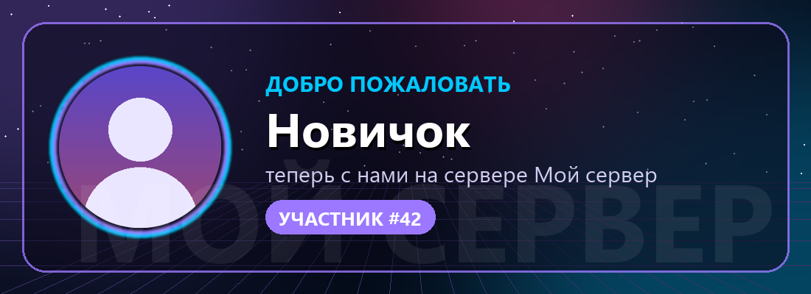
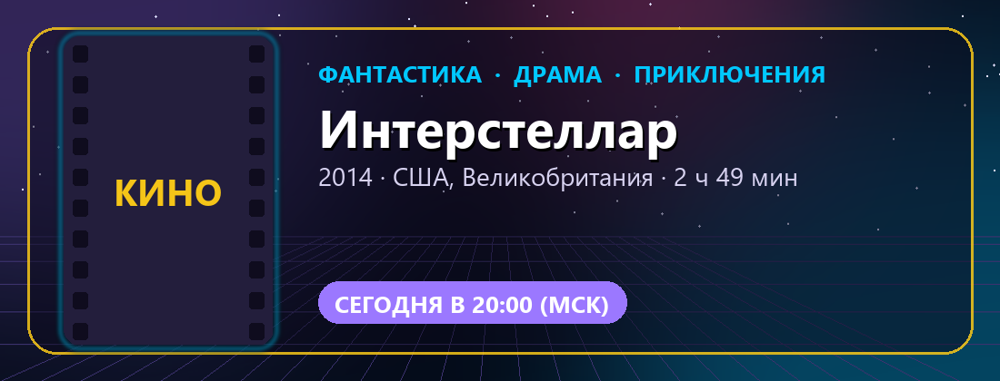
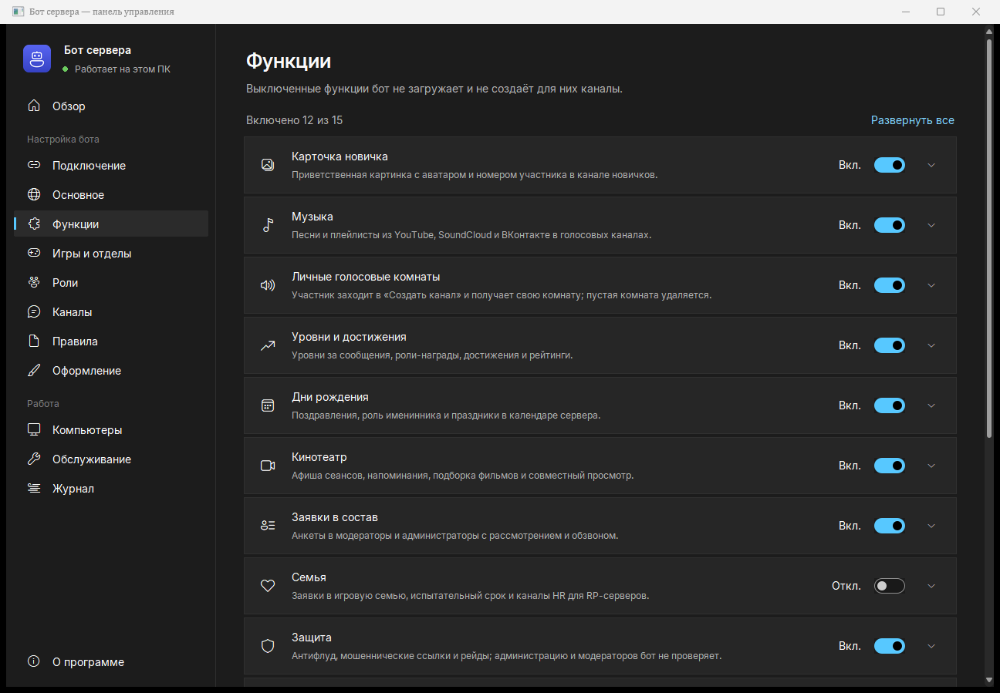
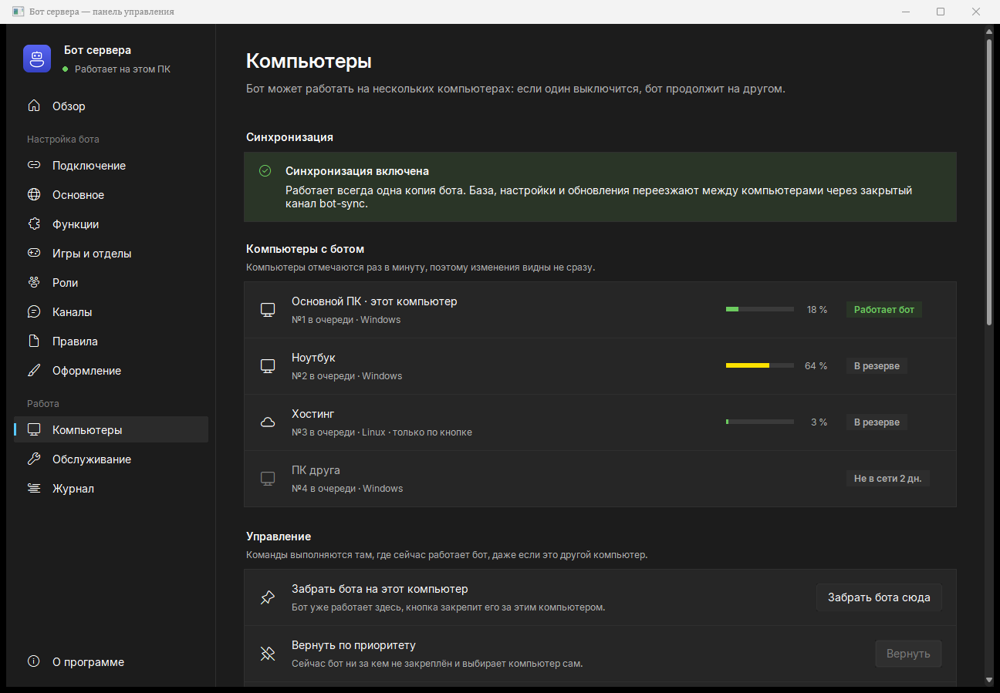

# Бот для игрового Discord-сервера

Русскоязычный бот, который сам строит сервер и держит в нём порядок: анкета для новичков, игровые отделы со своими
администраторами, музыка, личные голосовые комнаты, уровни и достижения, дни рождения, кинотеатр, заявки в
администрацию, защита от спама и многое другое.

Всё настраивается в **панели управления** — обычной программе для Windows, без правки файлов и без
программирования. Бот может работать на нескольких компьютерах и на хостинге: если один выключился, бот сам
продолжит на другом.

  

  
  

## Содержание

1. [Возможности](#возможности)
2. [Что понадобится](#что-понадобится)
3. [Установка](#установка)
4. [Панель управления](#панель-управления)
5. [Что бот создаёт на сервере](#что-бот-создаёт-на-сервере)
6. [Несколько компьютеров и хостинг](#несколько-компьютеров-и-хостинг)
7. [Команды бота](#команды-бота)
8. [Обновление](#обновление)
9. [Если что-то не работает](#если-что-то-не-работает)
10. [Файлы и ручная настройка](#файлы-и-ручная-настройка)
11. [Безопасность](#безопасность)
12. [Для разработчиков](#для-разработчиков)

---

## Возможности

| Функция | Что делает |
|---|---|
| **Анкета новичка** | Новичок видит только правила и канал анкеты. Он выбирает пол, дату рождения и игры, после этого сервер открывается. Обойти анкету нельзя: роли, выданные другими ботами, ждут её завершения |
| **Игровые отделы** | У каждой игры своя роль, категория каналов (новости, чат, скриншоты, «Создать канал») и свой администратор отдела. Он модерирует только свой отдел |
| **Админ-панель в Discord** | Выдача и снятие ролей, предупреждения, тайм-ауты, кик и бан с выбором причины из правил, объявления, дни рождения участников, подсказки «кому какую роль выдавать» |
| **Мод-панель** | Отдельная панель для модераторов: только наказания, без опасных кнопок |
| **Карточка нового участника** | Картинка-приветствие с аватаркой и номером участника. Свой фон и цвета |
| **Музыка** | `/play` по названию или ссылке (YouTube, SoundCloud, ВКонтакте), плейлисты, подборки по жанрам, панель с кнопками |
| **Личные голосовые комнаты** | Участник заходит в «Создать канал» и получает свою комнату: может закрыть её, переименовать, задать лимит, пригласить или выгнать человека. Пустая комната удаляется сама |
| **Уровни и достижения** | Уровни за сообщения, роли за активность, достижения вроде «Полуночника» и «Меломана», таблицы рейтингов |
| **Дни рождения** | Поздравления в календаре, роль именинника на день, праздники |
| **Кинотеатр** | Сеансы с анонсом и напоминаниями, карточка фильма с обложкой, подборка фильмов с голосованием, событие в «Мероприятиях» |
| **Заявки в состав** | Анкета в модераторы и администраторы, рассмотрение кнопками, голосовой канал для собеседования |
| **Семья** | Для GTA RP и похожих игр: заявки в семью, HR, испытательный срок |
| **Защита** | Флуд, повторы, массовые упоминания, фишинговые ссылки, рейды, новые аккаунты |
| **Идеи и зал славы** | Идеи с голосованием, лучшие сообщения по реакциям, недельная сводка, напоминания `/remind` |
| **Каналы только для фото** | В каналах «скриншоты» бот удаляет сообщения без картинок |
| **Счётчик участников** | Голосовой канал с числом участников |
| **Каналы 18+** | Закрытые каналы для девушек и парней от 18 лет, доступ по данным анкеты |
| **Пересылка новостей** | Копирует посты из канала другого сервера в ваш канал |
| **Без сообщений о ветках** | Убирает служебное «начал(а) ветку» во всех каналах, сама ветка остаётся |

Любую функцию можно выключить. Выключенная функция не загружается и не создаёт каналов.

---

## Что понадобится

- Компьютер с **Windows 10 или 11**, который почти всегда включён: бот работает, пока работает компьютер.
  Можно добавить ещё компьютеры или хостинг, тогда бот не выключается вообще.
- Свой сервер Discord, на котором вы владелец или администратор.
- 15 минут. Python, FFmpeg и остальное установщик поставит сам.

Нет Windows? Бот работает и на Linux-сервере или в Docker, см. [хостинг](#хостинг-и-linux).

---

## Установка

### Шаг 1. Создайте бота в Discord

1. Откройте [discord.com/developers/applications](https://discord.com/developers/applications) и войдите.
2. Нажмите **New Application**, введите имя бота и нажмите **Create**.
3. Слева откройте раздел **Bot**:
   - нажмите **Reset Token**, затем **Copy**. Это ключ бота, он понадобится на шаге 3.
     Ключ даёт полный доступ к боту: никому его не показывайте;
   - ниже, в блоке **Privileged Gateway Intents**, включите **Server Members Intent** и
     **Message Content Intent**, затем нажмите **Save Changes**.
4. По желанию: в разделе **General Information** загрузите аватар и описание бота.

### Шаг 2. Скачайте и установите

1. Вверху этой страницы нажмите **Code**, затем **Download ZIP**.
2. Распакуйте архив: правой кнопкой мыши → **Извлечь всё**.
3. В распакованной папке дважды щёлкните **`УСТАНОВИТЬ.bat`**.
   Если Windows покажет «Система Windows защитила ваш компьютер», нажмите **Подробнее** → **Выполнить в любом случае**.
4. Подождите 5–10 минут. Установщик поставит Python, FFmpeg, Deno и библиотеки бота и скопирует бота в папку
   `C:\Users\<имя>\DiscordBot`. В конце откроется **панель управления**, а на рабочем столе появится ярлык.

> **Как потом открыть панель.** Ярлык на рабочем столе или файл **`Запуск.bat`**. Он лежит и в папке бота
> (`C:\Users\<имя>\DiscordBot`), и в скачанной папке. Скачанный `Запуск.bat` сам найдёт установленного бота.

### Шаг 3. Подключите бота

Панель откроется на разделе **Подключение**.

1. Вставьте ключ бота из шага 1 и нажмите **Проверить**. Панель покажет имя бота и включены ли нужные разрешения.
2. Нажмите **Пригласить**, выберите свой сервер и подтвердите. Боту нужны права администратора, чтобы создавать
   каналы и роли.
3. Снова нажмите **Проверить** и выберите сервер в списке.
4. Внизу окна нажмите **Сохранить** (или Ctrl+S).

### Шаг 4. Настройте под свой сервер

Пройдите разделы слева. Подробно каждый описан ниже, в [Панели управления](#панель-управления).

- **Основное** — имя бота, название сервера, часовой пояс.
- **Функции** — что включить и как настроить.
- **Игры и отделы** — игры для анкеты и их категории.
- **Роли**, **Каналы** — названия. Если на сервере уже есть роль или канал с таким названием, бот возьмёт
  существующий.
- **Правила** — текст правил сервера.
- **Оформление** — фон и цвета карточки нового участника, с предпросмотром.

Изменения запоминаются только после **Сохранить**. До этого их можно отменить кнопкой **Отменить** внизу окна.

### Шаг 5. Постройте сервер

1. Откройте **Обслуживание** → **Что создаст бот** → **Проверить**. Появится список недостающих ролей и каналов.
   Ничего не меняется.
2. Нажмите **Построить сервер**. Бот создаст недостающее и разместит панели с кнопками.
   Он ничего не удаляет и не трогает существующие каналы.
3. В Discord откройте **Настройки сервера → Роли** и перетащите роль бота как можно выше, под роль владельца.
   Бот может выдавать только роли, которые находятся ниже его собственной.
4. Нажмите **Построить сервер** ещё раз: бот расставит роли по порядку.

### Шаг 6. Запустите бота

Откройте **Обзор** и нажмите **Запустить**. Через несколько секунд статус под именем бота сменится на
«Работает на этом ПК». Дальше бот будет запускаться вместе с Windows сам.

Проверьте результат: зайдите на сервер со второго аккаунта и пройдите анкету как новичок.

---

## Панель управления

Панель открывается ярлыком на рабочем столе или файлом `Запуск.bat`. Слева — разделы, под именем бота — его
текущее состояние.
Тема оформления повторяет Windows (светлая или тёмная), её можно сменить в разделе «О программе».

  

### Обзор

Главный экран: работает ли бот и где, сколько без перерыва, версия кода, когда сохранялась база.
Кнопки **Запустить**, **Перезапустить** и **Остановить**.

Пока бот не настроен до конца, здесь показан список «Первые шаги» с переходом к нужному разделу.
Если компьютеров несколько, видно, какие из них в сети и насколько загружены.

### Подключение

- Ключ бота: проверка ключа, подсказка, если не хватает разрешений.
- Выбор сервера и приглашение бота.

Ключ хранится только на этом компьютере (файл `.env`).

### Основное

- Имя бота: показывается в панели, ярлыках и установщиках.
- Название сервера: используется в приветствиях, правилах и на картинках.
- Ник бота на сервере.
- Часовой пояс и его подпись, например «20:30 (МСК)».

### Функции

Каждая функция бота — отдельный блок с переключателем. Раскройте блок, чтобы настроить детали:

- **Уровни** — сколько сообщений нужно на уровень;
- **Дни рождения** — во сколько поздравлять;
- **Заявки в состав** — через сколько дней можно подать повторно;
- **Защита** — пороги флуда, тайм-ауты, защита от рейдов;
- **Музыка** — ключ ВКонтакте для плейлистов;
- **Пересылка новостей** — список каналов-источников.

### Игры и отделы

Список игр для анкеты: эмодзи на кнопке, название, роль, дополнительные роли отдела. Для каждой игры бот создаёт
категорию с каналами и роль администратора отдела. Если у игры уже есть своя категория, укажите её ID:
бот её не перестраивает, только добавляет права администратора отдела.

### Роли

- Названия ролей администрации и участников, роли пола.
- Роли за сообщения, достижения с условиями.
- Именные роли с владельцами.
- Подсказки «кому выдавать» для админ-панели.
- Роли других ботов, которые должны стоять ниже всех.

### Каналы

Названия всех категорий и каналов, сгруппированные по функциям. Для важных каналов можно указать ID: тогда
канал можно переименовать в Discord, и бот всё равно его найдёт.

### Правила

Текст правил: вступление, разделы с пунктами, наказания, подпись. Подстановки:

| Подстановка | Что вставляется |
|---|---|
| `{server}` | название сервера |
| `{games}` | список игр |
| `{welcome}` | ссылка на канал анкеты |
| `{girls}`, `{boys}` | каналы 18+ |

Кнопка **Опубликовать в Discord** перевыкладывает правила в канале правил.

### Оформление

Фон, цвета и надписи карточки нового участника с живым предпросмотром. Те же цвета используются в карточках фильмов.

### Компьютеры

Режим нескольких компьютеров и хостинга. Подробнее — в [отдельном разделе](#несколько-компьютеров-и-хостинг).

### Обслуживание

- Проверка и построение сервера, публикация правил.
- Обновления: версия кода, рассылка на другие компьютеры, проверка.
- Резервные копии базы.
- Автозапуск вместе с Windows, ярлык на рабочем столе, быстрый доступ к файлам.

### Журнал

Журналы бота, диспетчера и самой панели. Поиск, фильтр «Только ошибки», обновление в реальном времени.

### После сохранения

Бот применяет новые настройки после перезапуска. После **Сохранить** панель предложит **Перезапустить сейчас**.
Если компьютеров несколько, настройки сразу уйдут и на остальные.

---

## Что бот создаёт на сервере

Названия можно поменять в разделе **Каналы**. Если канал с таким названием уже есть, бот возьмёт его.

| Категория | Каналы |
|---|---|
| **Информация** | правила, старт (анкета), новички, новости |
| **Общение** | общий чат, мемы; каналы 18+, если включены |
| **Активность** | календарь, уровни, достижения, идеи, лучшее |
| **Голосовые** | управление комнатой, «Создать канал», счётчик участников |
| **Игра** (по категории на каждую) | новости, чат, скриншоты, «Создать канал» |
| **Кинотеатр** | афиша, подборка, кинозал |
| **Заявки в состав** | подать заявку, заявки, ожидание собеседования |
| **Семья** | если включена |
| **Админка** | админ-панель, mini-панель, мод-панель, чаты, логи, рейтинги, настройки кино |

Роли: участник, новичок без анкеты, главный админ, главный модератор, администрация, модератор, роли пола, роли игр
и администраторов отделов, уровни, достижения, именинник, киноман.

Права:

- новичок без анкеты видит только правила, канал анкеты и приветствия;
- категорию игры видят только те, кто выбрал эту игру;
- администратор отдела модерирует только свой отдел;
- админку видят только администрация и главный модератор, модераторы — свою мод-панель и мод-чат.

---

## Несколько компьютеров и хостинг

Бота можно поставить на несколько компьютеров (свой, друзей — до пяти и больше) и на хостинг. Работает всегда
**ровно одна копия**:

- выключился компьютер, на котором работал бот, — примерно через минуту бот продолжит на другом;
- **самый свободный компьютер** (включено по умолчанию): каждый компьютер сообщает свою нагрузку. Если на
  компьютере с ботом начали играть и он сильно загружен, а другой заметно свободнее, бот переедет туда. Переезд
  происходит не чаще раза в 10 минут и никогда во время музыки;
- без этого режима бот работает строго по **номеру в очереди**: №1 всегда забирает бота себе, №2 подменяет его;
- режим **«Только по кнопке»**: такой компьютер никогда не забирает бота сам. Бот перейдёт на него, только если
  нажать **Забрать бота сюда**;
- база (уровни, дни рождения, фильмы), настройки и обновления переезжают вместе с ботом.

Всё это идёт через закрытый служебный канал `bot-sync` на вашем сервере, без сторонних сервисов.

  

**Как включить**

1. Раздел **Компьютеры** → **Включить синхронизацию**, затем согласитесь перезапустить бота.
2. В блоке «Установщик для другого компьютера» укажите имя, тип, номер в очереди и режим, нажмите
   **Собрать на рабочий стол**.
3. Передайте архив на тот компьютер лично (флешка, личное сообщение): в нём ключ бота.
4. Там распакуйте архив и запустите `УСТАНОВИТЬ.bat`. Больше ничего делать не нужно.

**Управлять можно с любого компьютера.** Раздел «Компьютеры» показывает все компьютеры: где работает бот, кто в
резерве, кто не в сети и насколько загружен. Кнопки работают, где бы ни был бот:

| Кнопка | Что делает |
|---|---|
| Перезапустить бота | перезапускает бота там, где он сейчас работает |
| Забрать бота на этот компьютер | переносит бота сюда и закрепляет: очередь и нагрузка не действуют |
| Вернуть по приоритету | снимает закрепление |
| Опубликовать обновление (раздел «Обслуживание») | рассылает код и настройки на все компьютеры |

В Discord то же самое показывает команда `/status`.

### Хостинг и Linux

Бот работает и без Windows: на VPS, в Docker или на хостинге с панелью для ботов. Хостинг может быть одним из
компьютеров в очереди (например, всегда включённым №1) или единственным местом, где работает бот.

В разделе **Компьютеры** выберите тип «Хостинг или сервер» и соберите архив. Внутри будет `ПРОЧТИ-ХОСТИНГ.txt`:

| Вариант | Как запустить |
|---|---|
| **VPS** (Ubuntu, Debian) | распаковать и выполнить `bash install/install.sh`: скрипт поставит всё и включит автозапуск (служба `discord-bot`) |
| **Docker** | `docker compose up -d --build` |
| **Хостинг с панелью** (Pterodactyl и похожие) | загрузить файлы, файл запуска `supervisor.py`, зависимости `requirements.txt` |

Если синхронизация не включена, бот будет работать только на хостинге. На своём компьютере его тогда нужно
остановить, иначе запустятся два бота.

Без архива тоже можно: скопируйте `.env.example` в `.env` и впишите ключ бота и ID сервера. Имя и номер в очереди
задаются переменными окружения `HOST_NAME` и `HOST_PRIORITY`.

---

## Команды бота

Большинство функций работает кнопками в каналах: анкета, админ-панель, комнаты, кинотеатр.

| Для всех | |
|---|---|
| `/play` `/genre` `/skip` `/pause` `/queue` `/volume` `/stop` | музыка |
| `/room …` | своя голосовая комната: имя, лимит, закрыть, пригласить, выгнать |
| `/rank` `/top` `/achievements` | уровень, топ, достижения |
| `/birthday set` `/birthday list` `/birthday privacy` | дни рождения |
| `/remind` | напоминание: `30м`, `2ч`, `1д` или `18:30` |

| Для администрации | |
|---|---|
| `/setup` | построить или достроить сервер (то же, что в панели) |
| `/setup-check` | показать, что `/setup` создаст, ничего не меняя |
| `/rules` | перевыложить правила |
| `/panels` | перевыложить панель анкеты |
| `/dept-admin add` / `remove` | назначить или снять администратора отдела |
| `/birthday add` / `remove` | день рождения участнику |
| `/digest` | итоги недели прямо сейчас |
| `/status` | где работает бот, все компьютеры |
| `/welcome-test` | карточка приветствия на себе |

---

## Обновление

Скачайте новый ZIP с этой страницы и скопируйте файлы в папку бота с заменой. **Не заменяйте**:

- `.env`, `settings.json`, `rules.json`, `host.json`;
- `bot.db`;
- папку `runtime`.

Затем в панели: **Обзор → Перезапустить**.

Если компьютеров несколько, обновите один и нажмите **Обслуживание → Опубликовать обновление**:
остальные обновятся сами в течение минуты.

---

## Если что-то не работает

| Проблема | Что сделать |
|---|---|
| Бот не в сети | **Обзор → Запустить**. Подробности — в разделе **Журнал** |
| «Ключ не подходит» | На портале: Bot → **Reset Token**, вставьте новый ключ в **Подключение** |
| Бот не видит участников или текст сообщений | Не включены Server Members Intent и Message Content Intent (шаг 1). **Подключение** показывает, какое из них выключено |
| Бот не выдаёт роли | Роль бота должна быть выше выдаваемых ролей: Настройки сервера → Роли |
| Нет слэш-команд | Подождите минуту после первого запуска и перезапустите Discord (Ctrl+R) |
| Не играет музыка | Установщик ставит FFmpeg сам. Если не получилось: `winget install Gyan.FFmpeg` и перезагрузка. Путь к FFmpeg можно указать в **Функции → Музыка** |
| Не рисуются картинки после включения без интернета | Windows (Smart App Control) иногда блокирует библиотеку картинок без сети. Перезапустите бота, когда появится интернет |
| Ошибки бота | Бот пишет их в канал логов в админке и в **Журнал** |

---

## Файлы и ручная настройка

Всё ниже меняется в панели. Файлы пригодятся для резервной копии или переноса на другой компьютер.

| Файл | Что в нём |
|---|---|
| `Запуск.bat` | открывает панель управления |
| `УСТАНОВИТЬ.bat` | установка или переустановка на этом компьютере |
| `settings.json` | ваши настройки: только то, что отличается от `settings.example.json` |
| `settings.example.json` | все настройки со значениями по умолчанию, не меняйте его |
| `rules.json` | правила сервера, если вы их меняли (иначе используются `rules.example.json`) |
| `.env` | ключ бота, ID сервера и служебные данные синхронизации — **не показывайте никому** |
| `host.json` | имя этого компьютера, номер в очереди и режим |
| `assets/welcome_bg.png` | ваш фон карточки нового участника |
| `bot.db` | база: уровни, дни рождения, фильмы; копии — в `runtime/backups` |

---

## Безопасность

- Ключ бота (`.env`) и база (`bot.db`) хранятся только на ваших компьютерах и никогда не попадают в git
  (см. `.gitignore`).
- Если ключ мог утечь, нажмите на портале **Reset Token** и вставьте новый ключ в панели.
- Бот ничего не удаляет на сервере:
  - в существующие каналы он только **добавляет** права своих ролей (новичок без анкеты, администратор
    отдела), остальные права не трогает;
  - полностью он настраивает только свои служебные категории: админку и созданные им категории игр.

---

## Для разработчиков

- Бот — Python и discord.py. Точка входа — `bot.py`, функции — в `cogs/`.
- Диспетчер нескольких компьютеров — `supervisor.py` и `sync.py`.
- Панель управления — пакет `manager/` (Tkinter и тема sv-ttk). Устройство панели и правила оформления описаны в
  [`manager/DEVELOPING.md`](manager/DEVELOPING.md).
- Проверка раздела панели без запуска настоящего бота:
  `python -m manager.devtools check <раздел>`.
- Проверка, что каждая настройка редактируется в панели: `python -m manager.coverage`.

## Лицензия

Код — [MIT](LICENSE). Шрифт Inter — [SIL Open Font License 1.1](assets/fonts/Inter-OFL.txt).
Значки — Segoe Fluent Icons из состава Windows.
